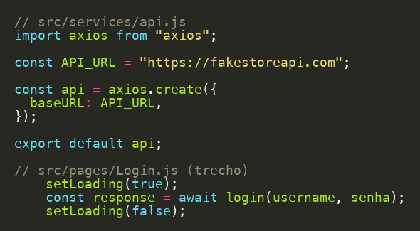
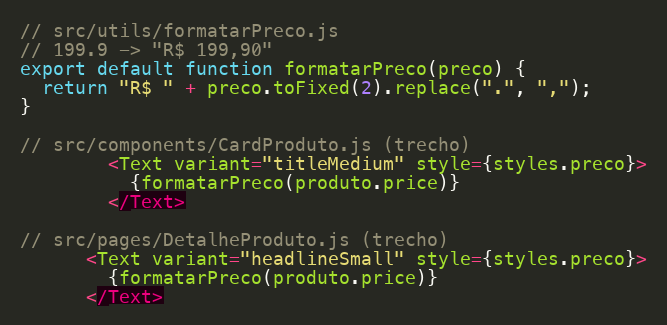
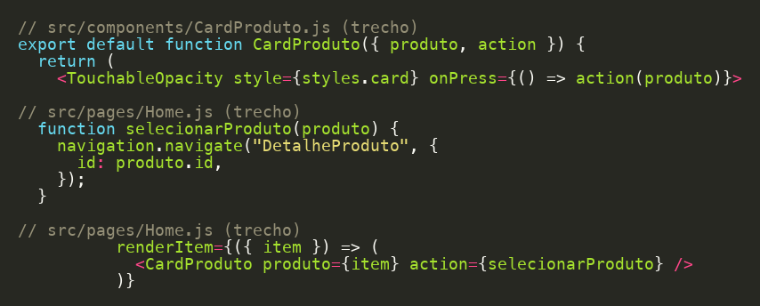

# Trabalho Refatorando: React Native – Consumo de API (G1)

## Integrantes

| Nome | RA |
| --- | --- |
| Carlos Eduardo Zanin | 1138275 |
| João Vitor da Silva | 1138170 |
| Leonardo Grimm Maziero | 1137914 |
| Pedro Henrique Moreschi Rizzotto | 1138024 |


## Boas práticas que ja usamos

### Separação de responsabilidades (SRP)



As chamadas da api ficam no api.js e nos services, a tela so chama a função.

### DRY



O formatarPreco é usado no card e no detalhe, entao a formatação do preço ta num lugar so.

### Injeção de dependência



O CardProduto recebe a função do clique pela prop action, ele nao depende do navigation.

## O que melhoramos

### Coesão nas telas

A Home e o DetalheProduto repetiam o mesmo código de loading/erro pra carregar os dados. Passamos isso pro hook useRequisicao, porque era o código mais repetido do projeto.

```js
const { dados: produto, loading, erro } = useRequisicao(() => buscarProduto(id), [id]);
```

### Acoplamento da Home com a API

A Home tinha um if pra escolher qual endpoint chamar. Agora tem so um buscarProdutos(categoria) no service que decide isso, e o try/catch repetido foi pro requisicao.js.
